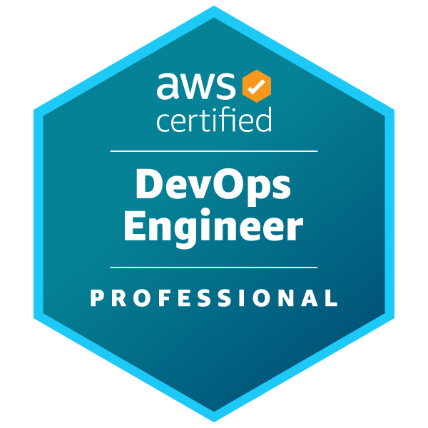
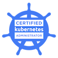

### Hello world, I'm Jin.
<!---->
<!---->

SI 백엔드 개발로 시작해 Cloud MSP를 거쳐 지금은 AWS 위에서 인프라와 배포 파이프라인을 만드는 DevOps 엔지니어입니다.

**Work** · EKS · Karpenter · Istio · ArgoCD · Terraform · Jenkins 
**Recent** · EKS 멀티테넌트 SaaS 플랫폼 DevOps 전담 (DRS ETL 설계, 부하테스트) · 30개 서비스 수작업 배포를 공통 Jenkins 파이프라인으로 전환 
<!-- **Certs** · AWS DevOps Engineer – Professional · CKA -->

### Writing

운영하면서 겪은 문제와 해결 과정을 기록합니다.

 [jaylab.blog](https://jaylab.blog) · 👤 [About / Career](https://jaylab.blog/about)

### Here on GitHub

업무 패턴을 다시 구성한 레퍼런스, 개인 실습 기록, 팀 프로젝트가 있습니다.

<!-- =================================================================== -->
<!-- Profile Summary Cards -->
<!-- =================================================================== -->

<!-- =================================================================== -->
<!-- (BACKUP) Readme Stats-->
<!-- =================================================================== -->
<!---->
<!--
-->

<!-- =================================================================== -->
<!-- 기술 스택 -->
<!-- =================================================================== -->

<!---->

 

 

<!---->

<!---->

<!-- =================================================================== -->
<!-- Certification -->
<!-- =================================================================== -->

<!--  -->

<!-- =================================================================== -->
<!-- Footer -->
<!-- =================================================================== -->
<!--  -->
